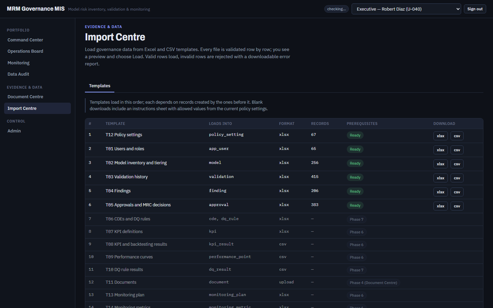

# FT-01 — Writes fail with "database is locked" when the run folder is inside OneDrive
Severity: Medium | Scenario: FS-15, FS-21 (collateral FS-16, FS-17, FS-23) | Criterion / BRD §: blocks DOC-01, DOC-02, DOC-17, GEN-02 | Role: Admin | Status: New

Not a defect in the application. Recorded because it blocks acceptance scenarios and must be
resolved before this suite can prove anything, and because the fix belongs to the harness/runbook.

## Steps to reproduce
1. Put the run folder inside the OneDrive-synced project tree (the default for this repository):
   `D_Reviews/DD_functional_test/<date>/env/functional.db`.
2. `MRM_DATABASE_URL=sqlite:///<that path>`, `MRM_STORAGE_BACKEND=local`.
3. Run the whole functional project: `npx playwright test --project=functional`.
4. Watch `POST /api/documents`, `POST /api/documents/batches`, `POST /api/admin/reset`
   and `GET /api/auth/dev-users`.

## Expected (CLAUDE.md)
> "DOC-01 — a single PDF can be uploaded against a model and is retrievable afterwards." (§78)

A write that the role is permitted to make must either succeed or fail with a business error.
HTTP 500 is neither.

## Actual
HTTP 500 on nine requests across the run: `POST /api/documents` (x1),
`POST /api/documents/batches` (x1), `GET /api/auth/dev-users` (x2), `POST /api/admin/reset` (x2),
plus three further document writes.

```
sqlalchemy.exc.OperationalError: (sqlite3.OperationalError) database is locked
  app/documents/service.py:219 in store_version -> db.commit()
```

A plain read was starved out too, which is the clearest sign it is lock contention and not logic:

```
sqlite3.OperationalError: database is locked
[SQL: SELECT app_user.user_id, ... FROM app_user WHERE app_user.active IS 1 ORDER BY app_user.user_id]
  app/services/user_service.py:35 in list_users   (via app/api/auth.py:23 dev_users)
```

**Re-run in isolation, same database, same server: `FS-15 ... 1 passed (5.2s)`.** The scenario is
correct and the application is correct; only concurrency differs.

## Evidence

Log excerpt: above, from the backend run log of commit 5c81cb9.
Isolation proof: `npx playwright test --project=functional -g "FS-15"` -> 1 passed.

## Root cause
Layer: environment / test harness · Location: `A_Codes/AF_e2e/playwright.config.ts` (`functional` project, worker count) and the run-folder location · Confidence: Confirmed

SQLite takes a database-level write lock. The `functional` project runs with Playwright's default
worker count, so several scenarios issue writes against one file at once, and a OneDrive sync
handler holds the file open on top of that. The default `timeout` of the sqlite3 driver is short
enough that a contended commit raises rather than waits. The application's own behaviour is right:
`store_version` commits once, in one transaction, exactly as the layering rule requires.

The agent specification already warns about this ("never a synced folder"), and this run disregarded
it by placing `env/` under `D_Reviews/`, which is inside OneDrive.

## Suggested fix
Decide one of these; the first is the smallest change.
1. Pin `workers: 1` for the `functional` project. The suite is a journey suite, not a throughput
   test, and serial execution also removes cross-scenario interference from shared seed data.
2. Put the run database outside the synced tree — under the scratchpad or `%LOCALAPPDATA%` — and keep
   only reports, screenshots and traces under `D_Reviews/`.
3. Run the functional project against PostgreSQL, as `tests/test_postgres.py` and CI already do.
   This is the only option that exercises the same engine as production, and would also have caught
   the FK-width drift that `0006_document_fk_widths` fixed.

Options 1 and 3 together are what I would pick: serial for determinism, PostgreSQL for fidelity.
Do **not** "fix" this by widening the sqlite busy timeout in application code — that would be
tuning the product to suit the test environment.

## Regression test
None in the product. Add a harness guard instead: `prepare_inputs.py` (or a `globalSetup`) should
refuse to run when the resolved `MRM_DATABASE_URL` path lies under a known sync root
(`OneDrive`, `Dropbox`, `Google Drive`), citing this issue. Once the environment is settled, the
criteria that this blocked — DOC-01, DOC-02, DOC-17, GEN-02 — are proven by FS-15, FS-16, FS-17
and FS-21 passing in one full run.
