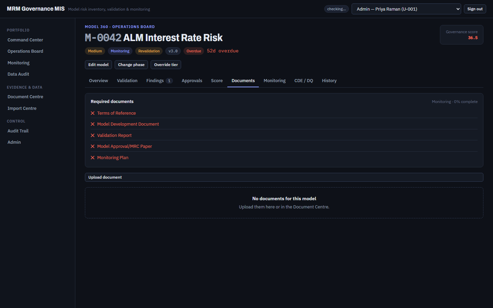
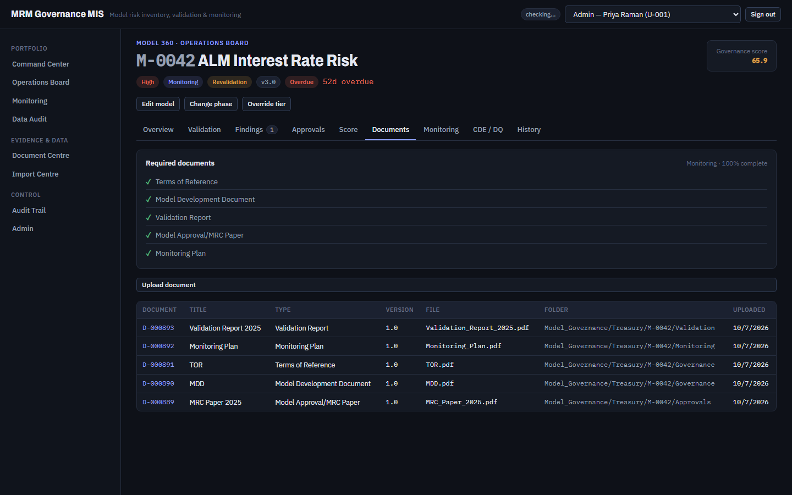

# FT-04 — "Reset to seed" over the API loads none of the 1,116 evidence documents and reports success
Severity: Critical | Scenario: FS-21 | Criterion / BRD §: GEN-01, §70, §64 (Reliability), §82.16 | Role: Admin | Status: New

The reset button the shipped dev UI offers (`Admin → Reset to seed`) deletes the portfolio's
evidence and then fails to reload it, silently. Reproduced **2 of 2** attempts, the second from an
empty database with nothing else running.

## Steps to reproduce
1. Create an empty SQLite database, `python -m app.cli bootstrap`, start the backend with the
   default `MRM_JOB_MODE=thread` (what `start_mrm.ps1` uses).
2. Sign in as Admin, open **Admin**, type `RESET` and press **Reset to seed**
   (or `POST /api/admin/reset`).
3. Wait. Poll `GET /api/admin/reset/status`.
4. Open any model's Model 360 → **Documents**.

## Expected (CLAUDE.md)
> "The reset function shall: 1. Clear/reset application data. … 8. Load documents/evidence metadata.
> 9. Recalculate derived fields." (§70)

> "GEN-01 — Reset to seed is deterministic: the same business date reproduces the same row counts
> and the documented portfolio distribution."

> "Partial batch failures shall not corrupt successful records." / "Failed background jobs shall be
> retryable." (§64 Reliability)

The committed seed holds 1,116 evidence documents; `python -m app.cli reset` loads all 1,116 (verified
three times in this run). The API reset must do the same — Part 0 states the CLI and the UI take the
same service path.

## Actual
`POST /api/admin/reset` returns **202** and the UI shows no error. The structured seed loads (256
models, 65 users, 415 validations, 206 findings, 383 approvals). The evidence does not:

| | after `cli reset` (inline) | after `POST /api/admin/reset` (thread) |
|---|---|---|
| `document` rows | 1,116 | **0** |
| M-0042 required documents | 5 of 5 present, 100% complete | **0 of 5**, 0% complete |
| M-0042 governance score | **65.9** | **36.5** |
| documents batch status | Completed | **Validating**, for ever |

The backend log records an unhandled exception in the background job:

```
Background job analyse_job failed
  File ".../app/documents/batch.py", line 243, in analyse_job
    db.flush()
sqlite3.OperationalError: database is locked
sqlalchemy.exc.OperationalError: (sqlite3.OperationalError) database is locked
```

Nothing of this reaches the user: `/api/admin/reset/status` keeps reporting `in_progress: true`
(see FT-05), and every screen simply shows a portfolio with no evidence.

## Evidence
  

`FT-04_actual.png` — M-0042 after an API reset: "No documents for this model", `Monitoring · 0%
complete`, all five required documents crossed, score 36.5.
`FT-04_expected.png` — the same screen after `cli reset`: five documents listed, `100% complete`,
score 65.9.

Trace: ../env/run.log (FS-21) · second, independent reproduction from an empty database:
`../env2/backend2.log` (`grep -c "database is locked"` → 2). The database state of both runs was
read out before the files were deleted and is kept at `../env_state.txt`:

```
== env2/functional2.db (clean db, one API reset)
   model 256
   document 0
   batch ('B-20260930-001', 'seed',      'reset', 'Completed',  6,    6, None)
   batch ('B-20260930-002', 'documents', 'seed',  'Validating', 1116, 0, None)
```

## Root cause
Layer: Service / Configuration (SQLite concurrency) · Location:
`A_Codes/AB_backend/app/documents/batch.py:243` (the per-item `db.flush()` in `analyse_job`),
contending with `A_Codes/AB_backend/app/services/reset_service.py:190-195` ·
Confidence: **Confirmed** for the failure and its consequences; **Likely** for the identity of the
contending writer.

`_reset_job` calls `load_seed_documents`, which calls `doc_batch.create_batch`; that submits
`analyse_job` to the thread pool (`batch.py:152`) and returns. `_reset_job` then immediately runs its
`finally` block and commits `batch.status = loaded_status` (`reset_service.py:194-195`) — the status
hold added by G0.18. The pool has two workers, so the two run at the same time.

`analyse_job` opens a transaction, **reads** the batch items, and then flushes — a lock *promotion*.
G0.17's own comment records that SQLite refuses a promotion that would roll back another writer by
returning `SQLITE_BUSY` **immediately, without consulting the busy handler**, so `busy_timeout` does
not help. WAL removed the reader-vs-writer case; it does not remove this one, because G0.18 put a
real writer right next to the submit.

Two things follow:
- The G0.17 plan row says this only arises on "FS-21's second reset while the first is still loading
  evidence". That is **not** correct: one reset, with no second caller, fails the same way. My
  reproduction (`env2`) had a single `POST /api/admin/reset` and nothing else writing.
- CI never sees it: every backend test runs with `MRM_JOB_MODE=inline`, which serialises the two jobs
  into one thread, and `cli reset` sets `job_mode = "inline"` explicitly (`app/cli.py:40`). The
  defect exists only on the path a user actually takes.

To raise confidence from Likely to Confirmed on the contending writer: move the status restore in
`_reset_job` to before the `create_batch` call (or await the documents batch), and re-run the API
reset; if the evidence then loads, the contender is identified.

## Suggested fix
Do not let the reset's own two jobs write concurrently. Options, in the order I would try them:
1. Have `load_seed_documents` perform the status restore itself, before `create_batch` submits
   `analyse_job`, so `_reset_job` has no write left to make.
2. Make `analyse_job` start its transaction as a writer (`BEGIN IMMEDIATE`) on SQLite, so it waits on
   the busy handler instead of failing the promotion.
3. Chain the jobs rather than overlapping them: `_reset_job` should submit the evidence load as its
   last act and return.

Whichever is chosen, `analyse_job` must also mark its batch `Failed` when it raises — that is FT-05,
and without it this defect is invisible.

## Regression test
Cite **GEN-01**. An integration test with `MRM_JOB_MODE=thread` (the suite has none today) that runs
`POST /api/admin/reset`, waits for `/api/admin/reset/status` to report `in_progress: false`, and
asserts `document` row count equals the seed's file count and the documents batch reached a terminal
status. FS-21 then exercises it end to end.
