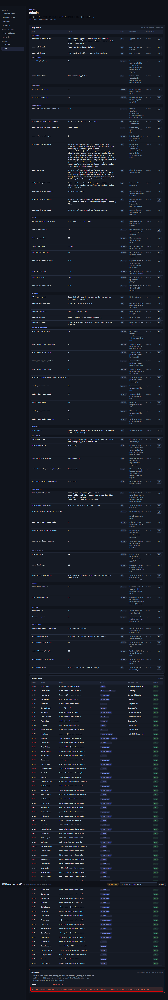
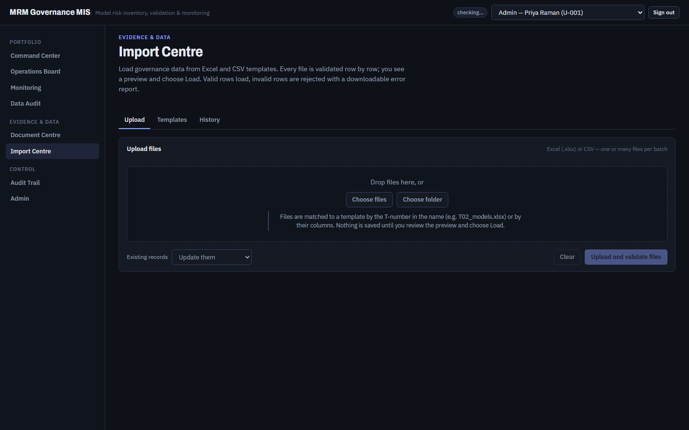

# FT-05 — A background job that raises leaves its batch non-terminal, and that permanently blocks every later reset
Severity: High | Scenario: FS-21 | Criterion / BRD §: GEN-05, §42 (batch statuses), §64 (Reliability), §66 (error handling) | Role: Admin | Status: **Verified** 2026-10-07 (fixed by G0.23, `e126a12`)

Independent of what makes the job fail (FT-04 is one cause, a bad file or a storage error would be
others): when a document batch job raises, nothing marks the batch failed. It sits in `Validating`
for ever, `/api/admin/reset/status` reports the reset as still running, and the application offers no
way out — the error message's own advice cannot be followed.

## Steps to reproduce
1. Trigger any document-batch job failure. The reliable one is FT-04: `POST /api/admin/reset` with
   `MRM_JOB_MODE=thread`.
2. `GET /api/admin/reset/status`.
3. `POST /api/admin/reset` again.
4. Follow the advice in the refusal: `POST /api/documents/batches/<id>/cancel`.

## Expected (CLAUDE.md)
> Import batch status list: "Uploaded · Validating · Validation Failed · Ready · Processing ·
> Partially Completed · Completed · **Failed** · Cancelled" (§42)

> "Failed background jobs shall be retryable." … "Partial batch failures shall not corrupt successful
> records." (§64 Reliability)

> "Errors shall be human-readable." (§66)

A job that dies must leave its batch in a terminal status that says so, and the operation must be
repeatable.

## Actual
```
GET  /api/admin/reset/status
  200 {"in_progress": true, "batch": {"batch_id":"B-20260930-009","status":"Validating",
       "total_files":1116,"successful_files":0,"error_message":null,...}}

POST /api/admin/reset
  409 {"detail":"A reset is already running: batch B-20260930-009 is Validating. Wait for it to
       finish and try again. If it is stuck, cancel that batch first."}

POST /api/documents/batches/B-20260930-009/cancel
  409 {"detail":"Batch B-20260930-009 is Validating and cannot be cancelled."}

POST /api/imports/batches/B-20260930-009/cancel
  404 {"detail":"Import batch B-20260930-009 does not exist."}
```

`error_message` is `null` and `successful_files` is 0, so no screen shows that anything went wrong —
the Import Centre lists the batch as in progress. The state is unrecoverable through the product:
only editing the database clears it. The advice in the 409 is impossible to follow.

## Evidence
  

`FT-05_actual.png` — Admin, after typing RESET and pressing **Reset to seed**: the refusal (outlined
in red) tells the user to cancel a batch that cannot be cancelled.

Trace: ../env/run.log (FS-21, retry #1 shows the 409) · Log excerpt: ../env/backend.log line 248
("Background job analyse_job failed") — the batch's status is never touched afterwards.

## Root cause
Layer: Service · Location:
- `A_Codes/AB_backend/app/workers/runner.py:24-27` — `_run` catches every exception and only logs it.
  Its comment says "job functions record their own failure"; `analyse_job` does not.
- `A_Codes/AB_backend/app/documents/batch.py:200-253` — `analyse_job` has no `try/except` that sets
  `batch.status = "Failed"` and `batch.error_message`.
- `A_Codes/AB_backend/app/documents/batch.py:35` and
  `A_Codes/AC_frontend/src/pages/documents/DocumentBatchReview.tsx:13` —
  `EDITABLE = ("Ready", "Validation Failed", "Failed")`. `Validating` is absent, so
  `doc_batch.cancel` (`batch.py:378-382`) refuses, in the API and in the UI.
- `A_Codes/AB_backend/app/services/reset_service.py:51-56, 110-130` — `reset_in_progress` treats any
  non-terminal batch as a running reset, so one wedged batch blocks resets for ever.

Confidence: **Confirmed**. Reproduced and each refusal observed directly, with the status codes above.

Note that `_reset_job` already guards the *seed* batch against exactly this (`reset_service.py:188-195`:
"leaving the batch stuck in Processing would block every later reset, which is worse than the failure
itself"). The documents batch has no equivalent guard.

## Suggested fix
Three small, independent changes; the first alone removes the wedge:
1. Wrap `analyse_job` and `confirm_job` in `try/except`, set `status = "Failed"` and
   `error_message` with the exception text, and commit — then `runner._run`'s comment becomes true.
2. Add `"Validating"` and `"Processing"` to the set a user may cancel (or give the reset an explicit
   "abandon stuck reset" action for `admin:reset` holders), so the 409's advice can be followed.
3. Treat a non-terminal batch older than a configurable age as not in flight in `reset_in_progress`,
   so the system recovers by itself.

## Regression test
Cite **§42** (and GEN-01 for the reset path). Make a document batch job raise — patch the storage
adapter to throw on the first file — and assert: the batch reaches `Failed` with a non-empty
`error_message`; `GET /api/admin/reset/status` reports `in_progress: false`; a second
`POST /api/admin/reset` returns 202, not 409.

---

## Verification, 2026-10-07 (functional-tester, Gate 0 exit **re-run**, commit `779e3de`)

**Verified.** Fixed by G0.23 (`e126a12`). Both halves of the issue were checked; the second was
checked live against the running application.

**1. A crashed job records its own failure.** `import_service.record_job_failure`
(`app/ingestion/service.py:36-65`) sets the batch `Failed` with `"<stage> failed: <type>: <msg>"`,
in its own session, never raising. It is wired into all three jobs that previously had no such
handling: document analysis (`app/documents/batch.py:235`), document storage (`:357`) and the reset
job's evidence staging (`app/services/reset_service.py:201`). Deliberately writes no audit event, on
the same reasoning as `engine._record`. I could not induce a job crash without editing product code,
which I do not do, so for this half the evidence is the wiring plus the three backend tests that
drive it (`tests/test_documents.py:399, :433, :456`) — **Confidence: Likely** for the runtime
behaviour, Confirmed for the code path.

**2. A wedged batch can be cancelled.** `CANCELLABLE = EDITABLE + ("Validating", "Processing")`
(`app/documents/batch.py:42`). Checked live rather than read: a 400-file document batch was uploaded
and, while its status was still `Validating`, `POST /api/documents/batches/{id}/cancel` returned
**HTTP 200** and the batch became `Cancelled`. Under the old `EDITABLE`-only rule that call returned
409, which is what left a user with no way out of the state FT-04 created. **Confidence: Confirmed.**

**3. The symptom is gone.** Across six resets in this run, no reset batch was left non-terminal:
every `source in ('reset','seed')` batch finished `Completed`, `/api/admin/reset/status` always
returned to `in_progress: false`, and every later reset was accepted. FS-21 asserts both — that no
reset batch is `Failed`, and that the status signal reaches idle.

Evidence: `../env5/logs/suite_authoritative.log`, `../env5/logs/backend.log`, the cancel probe
transcript in the report (§5).
