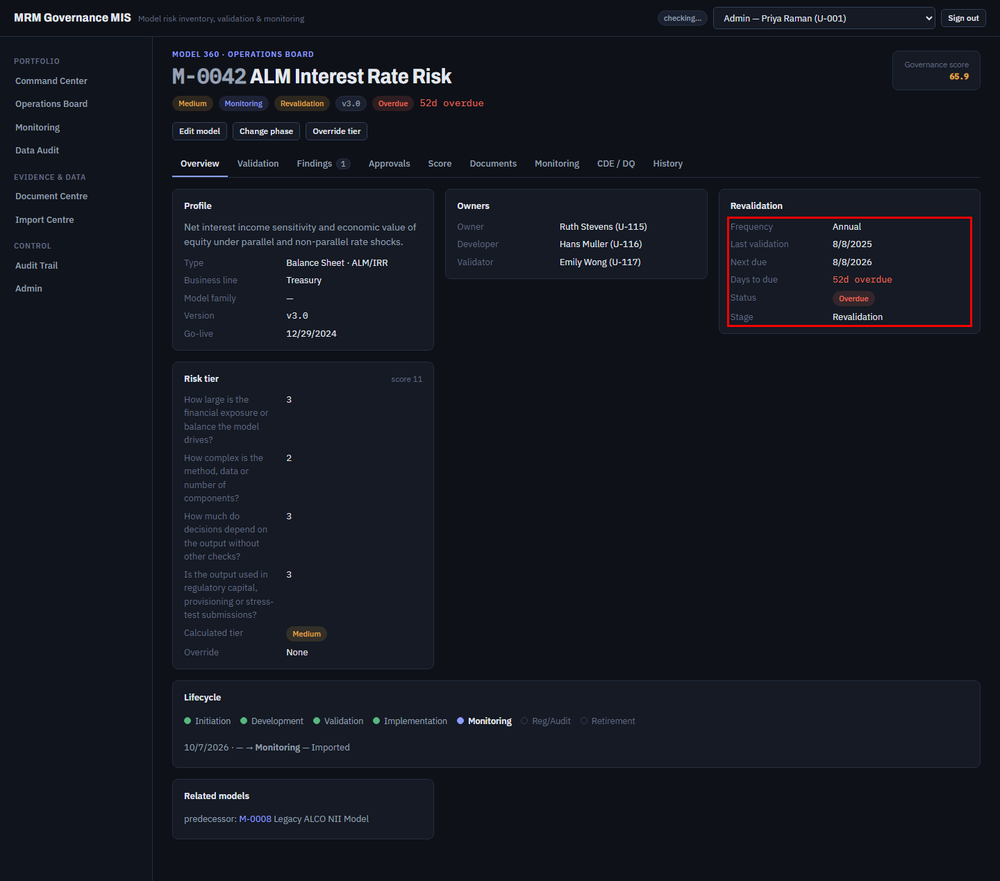
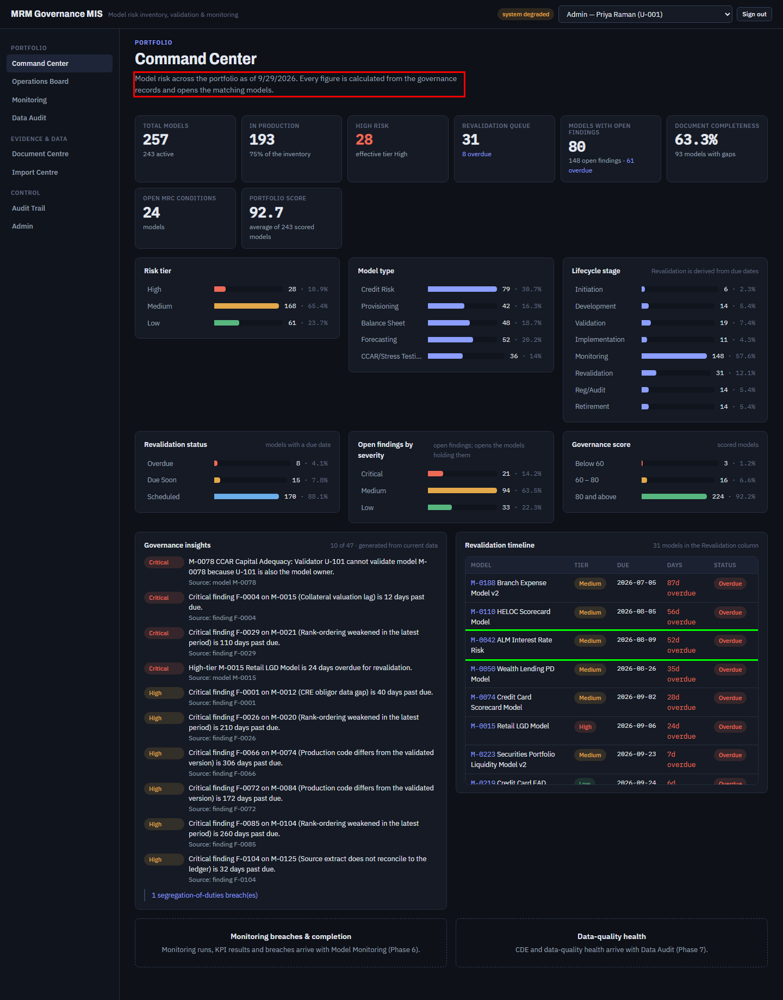

# FT-06 — Every date-only governance value is displayed one day early west of UTC
Severity: Medium | Scenario: FS-26 (new), FS-10, FS-18 | Criterion / BRD §: CC-01, LIF-02, §10, VAL-02, Part 0 ("the business date is `app.clock.today()`") | Role: any | Status: **Verified** 2026-10-07 (fixed by G0.24, `2c7d4b9`)

Found by looking at the screenshots of *passing* checkpoints, not by an assertion — no scenario
compares a rendered date with the API's. The Command Center states the wrong business date, and
Model 360 states the wrong next validation due date, for every user in a timezone behind UTC.

## Steps to reproduce
1. Run with `MRM_TODAY_OVERRIDE=2026-09-30` in any timezone behind UTC (this machine:
   America/New_York, UTC-4).
2. Open the **Command Center** and read the line under the title.
3. Open **Model 360 → M-0042** and read Last validation and Next due.
4. Compare with the Command Center's revalidation timeline, which prints the same field raw.

## Expected (CLAUDE.md)
> "The business date is `app.clock.today()`, never `date.today()` — `MRM_TODAY_OVERRIDE` fixes it for
> demos and tests so seeded overdue/revalidation states are reproducible." (Part 0)

> "The system shall display: Next due date. Days remaining. Days overdue. …" (§10)

> "VAL-02 — Next validation date equals last validation date plus the configured frequency, with
> month-end dates clamped to the last day of the target month."

> "REG-15 — … each figure equals the Command Center on the same business date" — which presumes the
> Command Center states the business date it is computed for.

## Actual
The server is right; the screen is wrong.

| Field | API | Screen |
|---|---|---|
| `GET /api/dashboard/summary` → `as_of` | `2026-09-30` | Command Center: "as of **9/29/2026**" |
| `GET /api/models/M-0042` → `last_validation_date` | `2025-08-09` | Model 360: "Last validation **8/8/2025**" |
| `GET /api/models/M-0042` → `state.next_due` | `2026-08-09` | Model 360: "Next due **8/8/2026**" |
| the same model in the Command Center timeline | `2026-08-09` | "**2026-08-09**" (correct) |

So two screens disagree about M-0042's next due date, and the one a user reads on the model's own
page is the wrong one. `go_live_date` and tier-override / phase-history dates shift the same way.

## Evidence
  

`FT-06_actual.png` — Model 360 M-0042, revalidation block outlined red: "Last validation 8/8/2025 ·
Next due 8/8/2026".
`FT-06_expected.png` — the Command Center: the lede outlined red ("as of 9/29/2026"), and the
timeline row for the same model outlined green showing the correct `2026-08-09`.

Also visible in the run's own passing checkpoints: `../screens/FS-18_tiles.png` (lede), 
`../screens/FS-10_revalidation.png`.

## Root cause
Layer: Frontend · Confidence: **Confirmed** ·
- `A_Codes/AC_frontend/src/pages/CommandCenter.tsx:112` —
  `` `… as of ${new Date(d.as_of).toLocaleDateString()}` ``
- `A_Codes/AC_frontend/src/pages/model360/Model360Page.tsx:23-25` —
  `function fmt(d) { return d ? new Date(d).toLocaleDateString() : "—"; }`, used at lines 57
  (Go-live), 66 (Last validation), 67 (Next due), 81, 91, 183.
- `A_Codes/AC_frontend/src/pages/documents/DocumentCentre.tsx:92` and
  `Model360Page.tsx:130` have the same shape on `uploaded_at`, which is harmless only because that
  value carries a time.

`new Date("2026-09-30")` is parsed by ECMAScript as a **date-only form**, which is interpreted as
UTC midnight. `toLocaleDateString()` then renders it in the browser's local zone, so anything behind
UTC prints the previous day. The API sends plain `YYYY-MM-DD` for every governance date, so every
one of them shifts. In UTC or ahead of it the bug is invisible, which is presumably why it has
survived — the mock-up parity run and CI both pass.

## Suggested fix
One shared formatter for date-only values that never constructs a `Date` in UTC: either render the
`YYYY-MM-DD` string directly, or parse it as local (`new Date(y, m-1, d)`). Put it next to the other
display helpers and use it in `CommandCenter.tsx:112` and `Model360Page.fmt`; keep `new Date(...)`
only for the timestamp fields that carry a time and a zone. A lint rule or a code comment at the
helper is worth more than fixing the two call sites, because the next date field will repeat it.

## Regression test
Cite **VAL-02** and **§10**. A functional assertion that the text rendered for "Next due" on Model
360 equals `state.next_due` from `GET /api/models/{id}`, and that the Command Center lede contains
the `as_of` the API returned — run with the test runner's timezone forced behind UTC
(`TZ=America/New_York`, or Playwright's `timezoneId`), so the test can fail.

---

## Verification, 2026-10-07 (functional-tester, Gate 0 exit **re-run**, commit `779e3de`)

**Verified.** Fixed by G0.24 (`2c7d4b9`): the new `AC_frontend/src/format.ts` reads the three
numbers out of a `YYYY-MM-DD` string and builds the date in **local** time, so a date-only value
cannot shift; `formatDateTime` still goes through `Date`, which is right for an instant.

Proved by **FS-26**, a scenario written for this issue and pinned to `timezoneId:
"America/Los_Angeles"` — the offset is invisible in UTC, which is why CI and the parity harness never
saw it. On the shifted timezone:

- the Command Center lede reads **"as of 9/30/2026"** for business date `2026-09-30`
  (`../screens/FS-26_command_center_as_of.png`); it read 9/29/2026 before;
- the revalidation timeline and Model 360 agree **character for character** on the same model's next
  due date (the serious half of MP-10 — two screens disagreeing about one governance date);
- M-0012's last validation renders its own calendar day.

I also checked the fix is complete rather than local to the two call sites the issue named: every
remaining `new Date(...)` in `AC_frontend/src` is on a timestamp (`occurred_at`, `created_at`,
`uploaded_at`), and the only place a date-only value still reaches the user as raw ISO is the
Operations Board **CSV export**, which `format.ts`'s own docstring says is correct ("Do not use it
for CSV export or for anything a machine reads").
