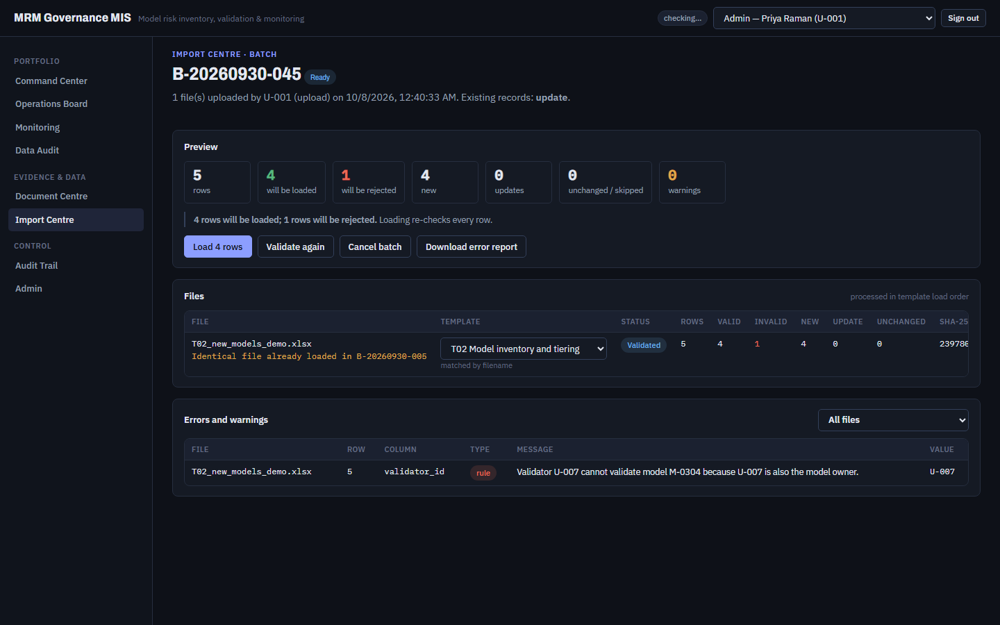

# FT-08 — Import preview always says "rows", so a single rejected row reads "1 rows will be rejected"
Severity: Low | Scenario: FS-03 (seen in a passing checkpoint) | Criterion / BRD §: §44, §66 ("Errors shall be human-readable") | Role: Admin | Status: New

Cosmetic, but it is on the screen the import demo spends the most time on, and §44 quotes the
sentence as the user-facing summary of partial acceptance.

## Steps to reproduce
1. Sign in as Admin, open **Import Centre**.
2. Upload `B_Inputs/AD_demo_files/T02_new_models_demo.xlsx` and press **Upload and validate**.
3. Read the line under the preview tiles.

## Expected (CLAUDE.md)
> "100 rows uploaded: 94 valid. 6 invalid. User sees: **94 rows will be loaded; 6 rows will be
> rejected.**" (§44)

§44's example happens to use plural counts on both sides, so the literal template is not wrong
there; §66 requires errors to be human-readable, and the demo file's documented split is 4 valid
and **1** invalid.

## Actual
> **4 rows will be loaded; 1 rows will be rejected.** Loading re-checks every row.

The same template produces "1 rows will be loaded" whenever a file has a single valid row.

## Evidence


The preview tiles above the line are correct (5 rows · 4 will be loaded · 1 will be rejected · 4 new
· 0 updates · 0 unchanged · 0 warnings), and the error row below names file, row, column, type,
message and original value exactly as §44 requires.

## Root cause
Layer: Frontend · Location:
`A_Codes/AC_frontend/src/pages/imports/BatchDetail.tsx:117` · Confidence: **Confirmed**

```tsx
<b>{validRows} rows will be loaded; {invalidRows} rows will be rejected.</b>
```

The word "rows" is a literal in both halves.

## Suggested fix
A tiny shared helper — `plural(n, "row")` — used here and anywhere else a count meets a noun. There
are several such places (`{b.total_files} file(s)` in the same file at line 95 solves it with
"(s)", which is a different answer to the same question); one helper would make them agree.

## Regression test
None worth adding on its own. If one is written, cite **§44** and assert the sentence for a
one-invalid-row file.

---

## Re-check, 2026-10-07 (Gate 0 exit re-run, commit `779e3de`)

**Still open, exactly as reported.** Not re-raised; it is plan **BL.22**. Visible in this run's
FS-03 checkpoint (`../screens/FS-03_preview.png`): *"4 rows will be loaded; **1 rows** will be
rejected."* The issue file's status stays `New` because `/triage-review` owns the move to
`Planned (BL.22)`.
