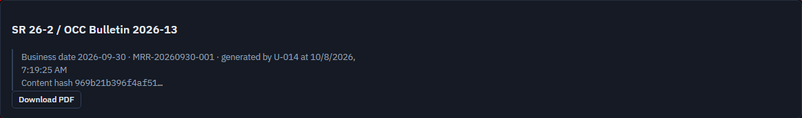
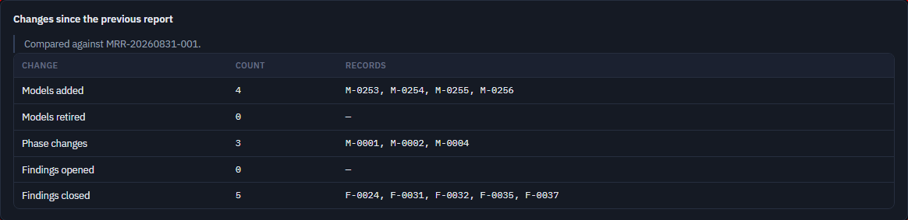
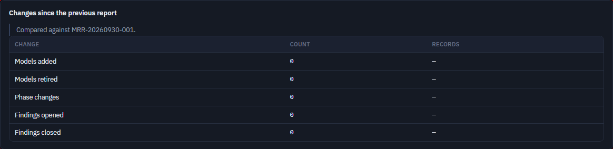

# FT-09 — Generating the report twice from the same data gives two different content hashes, whenever a predecessor exists
Severity: High | Scenario: FS-25 | Criterion / BRD §: **REG-16**, §12A REQ-REG-10A, §86 Principle 5 | Role: Validator (any `report:generate` role) | Status: New

The first product defect this gate's headline feature has shown. It is invisible to CI because the
backend fixture has no earlier report, and it was invisible to FS-25 until TR-39's fix landed — the
old assertion compared the first report's hash with itself. The very first thing the fixed scenario
did was fail on it.

## Steps to reproduce
1. `python -m app.cli reset` at business date 2026-09-30, so the database holds the seeded earlier
   report `MRR-20260831-001` and nothing else (this is what every demo and every functional run
   starts from).
2. Sign in as a Validator and open **Model Risk Report**.
3. Click **Generate report**. Note the id and the content hash.
4. Click **Generate report** again, with no governance write in between.
5. Compare the two content hashes.

## Expected (CLAUDE.md)
> **REG-16** — "Generating twice from the same data and business date gives the same content hash.
> Each generation writes one audit event."

and §12A REQ-REG-10A: "Generating twice from the same data and business date gives the same
content."

## Actual
Two generations two seconds apart, same business date, no write between them:

```
POST /api/reports/model-risk  ->  201  MRR-20260930-001  hash 969b21b396f4af51…
POST /api/reports/model-risk  ->  201  MRR-20260930-002  hash 7ecf126c7c6ceec1…
POST /api/reports/model-risk  ->  201  MRR-20260930-003  hash 7ecf126c7c6ceec1…
```

The third matches the second, so the divergence is exactly on the **first pair after a predecessor
whose baseline differs**. The difference is the `changes_since` section:

| | generation 1 | generation 2 |
|---|---|---|
| compared against | `MRR-20260831-001` (the seeded report) | `MRR-20260930-001` |
| models added | **4** (M-0253…M-0256) | 0 |
| phase changes | **3** (M-0001, M-0002, M-0004) | 0 |
| findings closed | **5** (F-0024, F-0031, F-0032, F-0035, F-0037) | 0 |

This is not demo-only. In production the same thing happens on any day a user generates the report
twice: the first generation reports a week's changes, the second reports none, and REG-16's equality
fails. It also means the stored `content_hash` cannot be used as "is this the same report as last
time" — which is the only thing a content hash is for.

FS-25 is reported as *flaky* by the runner for a mechanical reason worth knowing: on retry the
database already holds the two reports from the failed attempt, so the retry's two generations both
have an identical-baseline predecessor and the hashes agree. The scenario fails **deterministically
from a clean seed** — verified three times, with `--retries=0`.

## Evidence
  
  
Trace: ../traces/FS-25.zip

## Root cause
Layer: **Service** · Location: `A_Codes/AB_backend/app/services/report_service.py:55-73` (the
`_NOT_CONTENT` exclusion and `content_hash`), with `:222-267` (`_changes_since`) and `:339-341`
(`generate` taking `previous = latest(db)`) · Confidence: **Confirmed**

`content_hash` deliberately excludes the predecessor's *identity* from the digest so that two
generations match, and says so:

```python
#: Provenance, not content: which report came before does not change what this one says about the
#: portfolio. … The change *lists* stay in: those are findings about the portfolio, and they do differ.
_NOT_CONTENT = ("previous_report_id", "previous_generated_at")
```

The two halves of that comment contradict each other. If the predecessor's identity is provenance,
then the lists computed *only* from that predecessor are provenance too — they are a property of the
pair, not of the portfolio. Excluding the id while keeping everything derived from it removes the
symptom in the one case the unit test exercises and leaves it everywhere else.

Why CI does not see it: `test_reg_16_the_same_data_gives_the_same_content_hash`
(`tests/test_reports.py:170-185`) runs on `loaded_client`, which has **no** stored report when it
starts. Generation 1 therefore has `previous = None` and an empty `changes_since`; generation 2's
predecessor is generation 1, whose baseline is identical, so its `changes_since` is empty too. Both
hashes are hashes of an empty change section, and the test passes. The fixture, not the code, is
what makes it green — so the test reviewer's "the CI-gated unit test is strong" holds for everything
except this.

## Suggested fix
A decision first, because two readings of REG-16 are defensible:

- **(a) The hash is the portfolio's content.** Exclude the whole `changes_since` section from the
  digest, as `previous_report_id` already is — one line in `content_hash`. The section stays in the
  stored content and on the screen; it simply stops deciding whether two reports "say the same
  thing". This is the reading REQ-REG-10A's own sentence supports, since "the same data" means the
  governance records, and the predecessor is not one of them.
- **(b) The hash is the document.** Then REG-16 is wrong as written and should say "from the same
  data, the same business date **and the same previous report**", and the criterion stops being
  checkable from the UI.

(a) is the smaller change and keeps the criterion usable. Either way, the regression test must run
against a database that **already has a predecessor** — that is the whole content of this issue.

## Regression test
Cite **REG-16**. A backend test that seeds one earlier report (or calls
`report_service.seed_previous_report`) with a *shaped* baseline, then generates twice and asserts
the two `content_hash` values are equal — it must fail today. The existing
`test_reg_16_the_same_data_gives_the_same_content_hash` should keep its empty-database case and gain
this one, because the two prove different things. FS-25 already asserts it from the UI.
