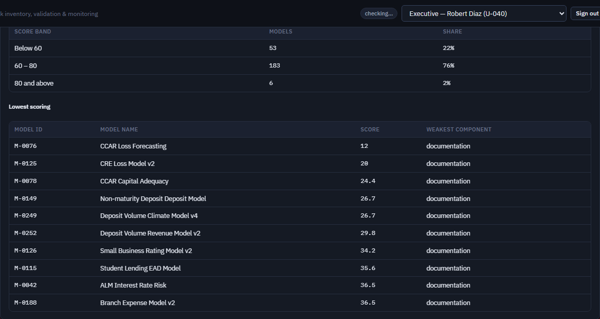
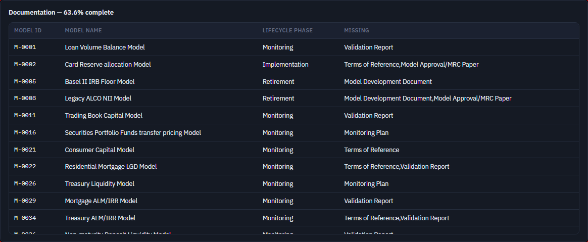
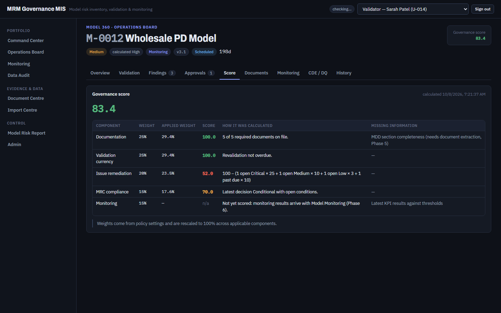

# FT-10 — The Model Risk Report prints internal keys and unseparated lists where every other screen prints labels
Severity: Low | Scenario: FS-25 (seen in a passing checkpoint) | Criterion / BRD §: REQ-REG-10A ("Governance score: … the lowest-scoring models with their weakest component"), §52 (one visual language), §66 ("Errors shall be human-readable") | Role: any read role | Status: New

Found by looking at the passing FS-25 screenshot, not by an assertion. FS-25 checks that the score
*bands* read as labels rather than as `below_warn` / `warn_to_good` — the same rule is broken one
column to the right, and in the documentation table.

## Steps to reproduce
1. Sign in as a Validator and open **Model Risk Report**; generate one.
2. Read the **Governance score → Lowest scoring** table, column "weakest component".
3. Read the **Documentation** table, column "missing".
4. For contrast, open **Model 360 → Score** for any model and read the Component column.

## Expected (CLAUDE.md)
> REQ-REG-10A — "Governance score: distribution by band, and the lowest-scoring models with their
> weakest component."

and §52's single visual language. The score rule already has human labels: `app/rules/score.py`
gives every component a `label` ("Validation currency", "Issue remediation", "MRC compliance"), and
Model 360's Score tab renders exactly that (`Model360Page.tsx:166`). The report is the artefact that
goes to the board, so it is the last place that should show the internal key.

## Actual
Two things on the same screen:

- **Weakest component** reads `validation_currency`, `issue_remediation`, `mrc_compliance`,
  `documentation` — the dictionary keys. Model 360 shows "Validation currency", "Issue remediation",
  "MRC compliance" for the same quantity.
- **Missing** in the Documentation table reads
  `Terms of Reference,Model Development Document,Validation Report,Model Approval/MRC Paper,Monitoring Plan`
  — a Python list stringified with no space after the comma, so at a glance "Reference,Model" looks
  like one document type.

Both come from the same place: `RowList` renders every cell as `String(r[c])`
(`ModelRiskReportPage.tsx:49-51`), which turns an array into a bare `join(",")` and leaves a
snake_case key untouched. CR-47 (raw ISO dates in the same tables) is the third symptom of the one
cause, so the three are best fixed together.

## Evidence
 — "weakest component" column, seeded report
 — "missing" column, today's report
 — Model 360 Score tab, same quantity, labelled

## Root cause
Layer: **Frontend** · Location: `A_Codes/AC_frontend/src/pages/ModelRiskReportPage.tsx:49-51`
(`RowList`'s `String(r[c])`) and `:155-156` (the `weakest_component` column); the value itself is
set in `A_Codes/AB_backend/app/services/report_service.py:_score` from the component `key`, where a
`label` is available on the same object · Confidence: **Confirmed**

## Suggested fix
Give `RowList` a small cell formatter: arrays join with `", "`, values for a column ending `_date`
go through `formatDate` (that closes CR-47), and `weakest_component` maps through the score
component labels. The cleanest version sends the **label** from the backend alongside the key, the
way `band_labels` already does for the bands — the screen then needs no vocabulary of its own.

## Regression test
Cite **REG-15**. Extend FS-25's existing "the score bands read as labels, not keys" assertion to the
Lowest-scoring table: `await expect(score).not.toContainText("validation_currency")`. A frontend
unit test on `RowList` asserting an array renders with separators would cover the second half.
