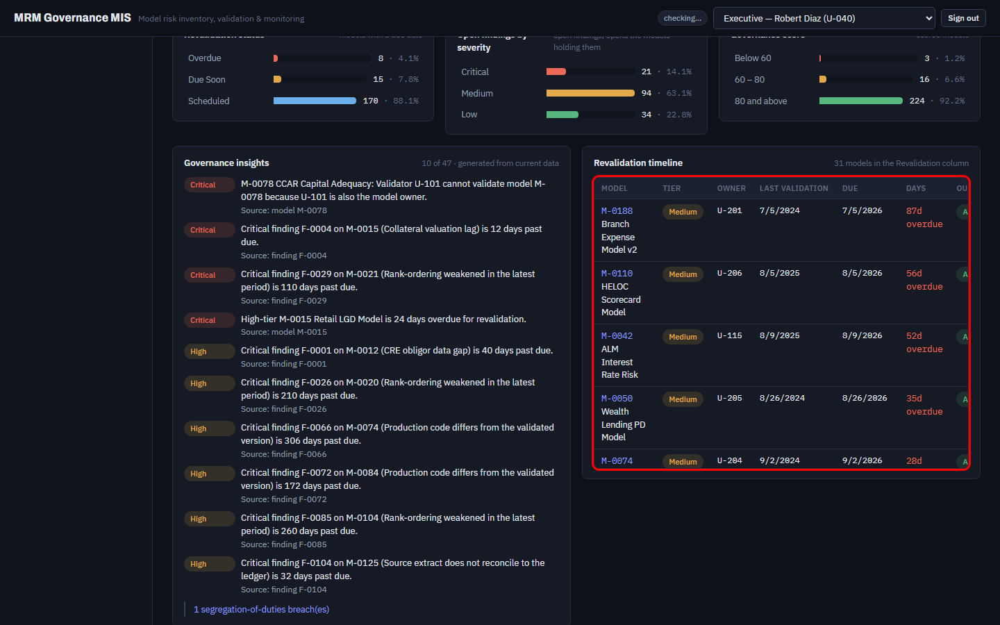
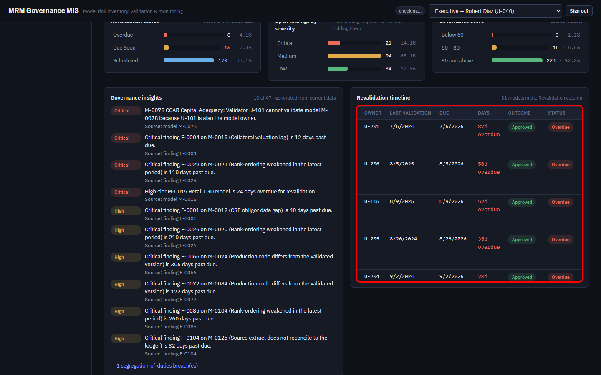

# FT-11 — The revalidation timeline's two rightmost columns are off-screen, including the Outcome column BL.24 just added
Severity: Low | Scenario: FS-28, FS-18, FS-26 (seen in passing checkpoints) | Criterion / BRD §: **§10** ("The system shall display: … Latest outcome"), CC-03, §52 (dense tables), §64 (UI) | Role: any read role | Status: New

BL.24 added Owner, Last validation and Outcome to the Command Center's revalidation timeline so
that "show me this owner's models due for revalidation" can be answered from a list. At the harness
viewport — 1440 × 900, the same one the mock-up parity run uses — the table no longer fits its
panel, and **Outcome and Status are entirely outside the window**. FS-28 passes because it reads
`innerText`, which includes content scrolled out of view.

## Steps to reproduce
1. Sign in as an Executive at a 1440 × 900 viewport.
2. Open **Command Center** and scroll to **Revalidation timeline**.
3. Read the table without touching it.

## Expected (CLAUDE.md)
> §10 — "The system shall display: Next due date. Days remaining. Days overdue. Risk tier. Owner.
> Last validation. Latest outcome."

The plan row records BL.24 as delivering exactly those columns: "Model / Tier / **Owner** / **Last
validation** / Due / Days / **Outcome** / Status". A column a user must discover by horizontally
scrolling an inner div is displayed only in the weakest sense, and Status — which was visible before
BL.24 — has been pushed out with it.

## Actual
Measured in the browser on the live app:

```
div.tablewrap (Revalidation timeline):  clientWidth 538   scrollWidth 698   overflow-x auto
column right edges (page x, viewport width 1440):
  Model 944 · Tier 1023 · Owner 1084 · Last validation 1203 · Due 1295 · Days 1367
  Outcome 1463   <- beyond 1440
  Status  1554   <- beyond 1440
```

160 px of the table is clipped. On screen the header row ends "… DAYS OU" and the Outcome pill shows
only its first letter. The panel sits in a two-column grid whose left neighbour (Governance
insights) is tall and whose right half of the page below is empty, so there is room — the table is
narrow because of the grid, not because of the page.

## Evidence
 — the panel outlined; Outcome and Status cut off
 — the same table scrolled fully right, where the two columns live
Also visible in ../screens/FS-18_tiles.png, ../screens/FS-26_command_center_as_of.png and
../screens/FS-28_revalidation_timeline.png.

## Root cause
Layer: **Frontend** · Location: `A_Codes/AC_frontend/src/pages/CommandCenter.tsx:173-199` — the
panel is inside a `div.cols` two-column grid, and the eight-column table is wrapped in
`div.tablewrap.scroll` (`overflow-x: auto`), so the browser scrolls rather than reflows ·
Confidence: **Confirmed** (measured, not inferred)

## Suggested fix
Give the timeline the full row (`style={{ gridColumn: "1 / -1" }}`, as the Lifecycle panel on
Model 360 already does) — it has eight columns and the widest cell content on the page, so it is no
longer a half-width panel. Alternatives, in order of preference: drop `model_name` from the Model
cell into a title attribute; or move Owner and Outcome under the model name as a sub-line, the way
the "Models with open findings" tile does.

## Regression test
Cite **§10** (the ID FS-28 carries). Add to FS-28 an assertion that each §10 column header's
bounding box lies inside the viewport — `expect(box.x + box.width).toBeLessThanOrEqual(1440)` — so
a column added later cannot push an existing one out of sight unnoticed. This is also worth a
`mockup-parity.md` checklist line for MP-17's screen.
